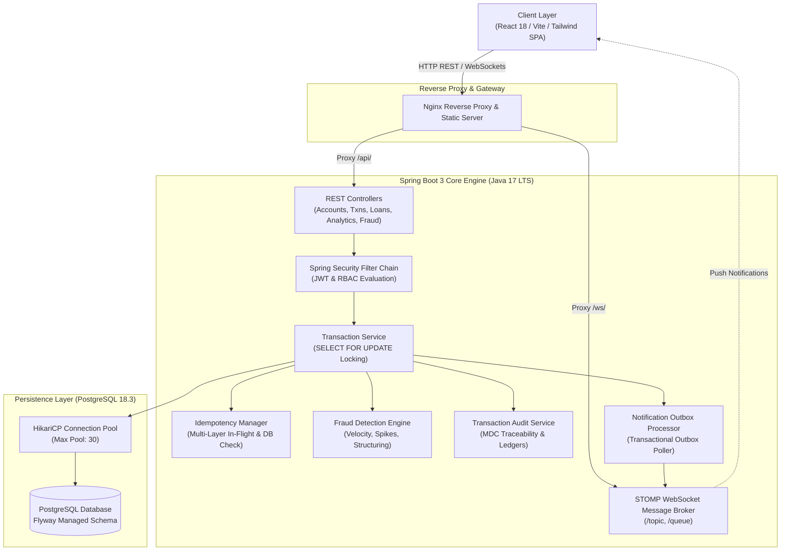
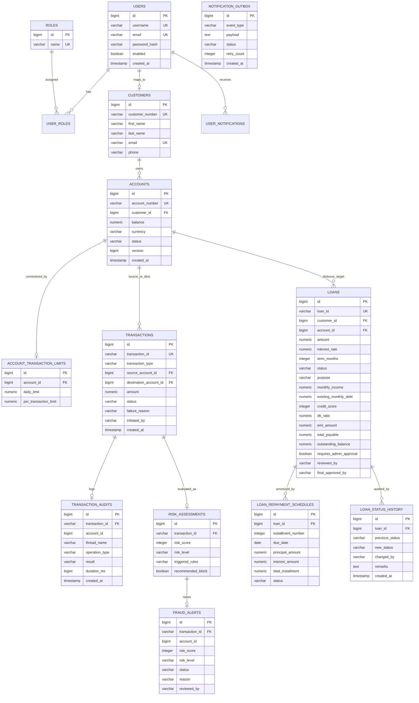
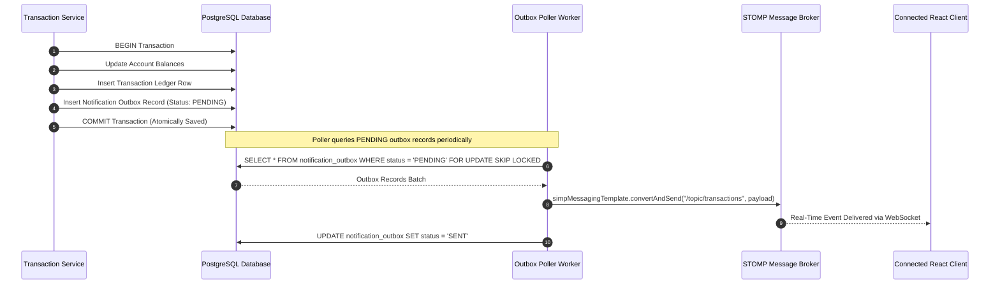
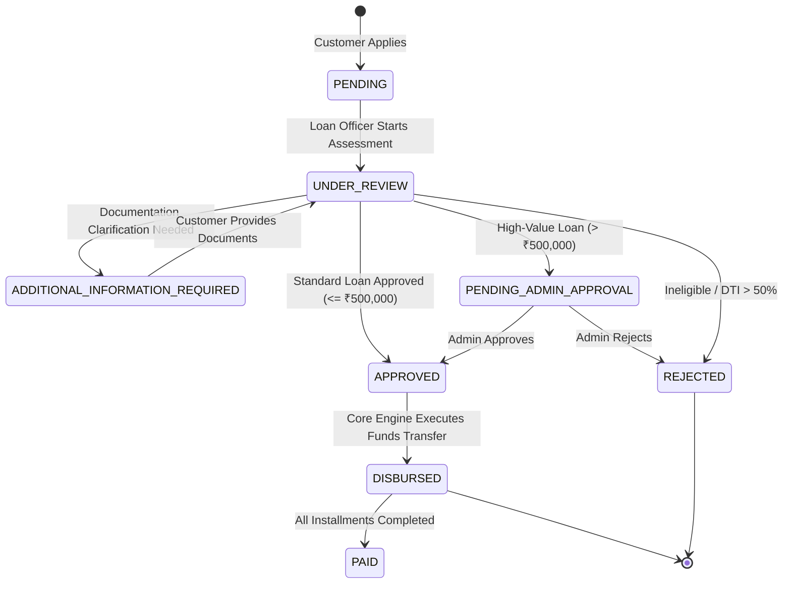

# Banking Transaction Processing System — Technical Architecture

This document provides a comprehensive technical architecture and design specification for the **Multi-Threaded Banking Transaction Processing System**, engineered as a final-year B.Tech capstone project.

---

## 1. System Topology & Architectural Overview

The application follows an enterprise-grade, tiered architecture prioritizing **strict ACID transaction isolation**, **high-concurrency throughput**, **deadlock-free deterministic locking**, **rule-based fraud surveillance**, and **event-driven client notifications**.

---

## 2. Database Schema & Entity Relationship Diagram

The PostgreSQL schema is managed via Flyway versioned migrations (`V1__init_schema.sql`, `V2__loan_management.sql`, `V3__loan_officer_rbac.sql`) enforcing primary keys, foreign keys, constraints, and audit columns.

---

## 3. Concurrency & Deadlock Prevention Model

### The Challenge: Circular Wait in Cross-Transfers
When two threads concurrently execute transfers between the same two accounts in opposing directions:
* **Thread A**: Transfer from Account 1 &rarr; Account 2
* **Thread B**: Transfer from Account 2 &rarr; Account 1

If Thread A acquires Lock(1) and attempts to acquire Lock(2), while Thread B acquires Lock(2) and attempts to acquire Lock(1), the database enters a **deadly circular wait (Deadlock)**, aborting one or both transactions.

### The Solution: Deterministic Ascending Lock Hierarchy
ApexBank eliminates deadlocks at the mathematical model level by enforcing strict **deterministic lock acquisition**:
$$\text{firstLock} = \min(\text{sourceId}, \text{destId})$$
$$\text{secondLock} = \max(\text{sourceId}, \text{destId})$$

Both threads are forced to acquire locks in the exact same physical order (`lowerId` first, `higherId` second). A circular wait condition is mathematically impossible.

```mermaid
sequenceDiagram
    autonumber
    participant ClientA as Thread A (Transfer 1 -> 2)
    participant ClientB as Thread B (Transfer 2 -> 1)
    participant Engine as Transaction Engine
    participant DB as PostgreSQL (SELECT ... FOR UPDATE)

    Note over ClientA,ClientB: Concurrent Cross-Transfer Requests Fired
    ClientA->>Engine: transfer(ACC1, ACC2, ₹100.00)
    ClientB->>Engine: transfer(ACC2, ACC1, ₹50.00)

    rect rgb(20, 30, 50)
    Note over Engine: Deterministic Ordering: min(ID_1, ID_2) = ID_1, max = ID_2
    Engine->>DB: Thread A: SELECT * FROM accounts WHERE id = 1 FOR UPDATE
    DB-->>Engine: Thread A acquires Row Lock(1)
    
    Engine->>DB: Thread B: SELECT * FROM accounts WHERE id = 1 FOR UPDATE
    DB-->>Engine: Thread B BLOCKED (waits on Row Lock 1 held by Thread A)
    end

    rect rgb(30, 40, 60)
    Engine->>DB: Thread A: SELECT * FROM accounts WHERE id = 2 FOR UPDATE
    DB-->>Engine: Thread A acquires Row Lock(2)
    Note over Engine: Thread A updates balances, writes ledger, audits, commits
    Engine->>DB: Thread A: COMMIT (Releases Locks 1 & 2)
    end

    rect rgb(20, 50, 40)
    DB-->>Engine: Thread B WAKES UP, acquires Row Lock(1)
    Engine->>DB: Thread B: SELECT * FROM accounts WHERE id = 2 FOR UPDATE
    DB-->>Engine: Thread B acquires Row Lock(2)
    Note over Engine: Thread B updates balances, writes ledger, audits, commits
    Engine->>DB: Thread B: COMMIT (Releases Locks 1 & 2)
    end

    Note over ClientA,ClientB: Both Transfers Complete with ZERO Deadlocks!
```

---

## 4. Transactional Outbox Pattern & Real-Time STOMP WebSockets

To guarantee that database updates and client notifications never drift (solving the dual-write problem), ApexBank implements the **Transactional Outbox Pattern**:

---

## 5. Role-Based Underwriting State Machine

Loan applications undergo structured underwriting enforcing distinct separation of duties:
* **Loan Officers** can evaluate creditworthiness, check DTI ratio, and recommend approval for standard loans.
* **Loans exceeding ₹500,000.00** require mandatory **Administrator final sign-off**.
* Self-approval is strictly forbidden.

---

## 6. High-Concurrency Performance Benchmark Results

The benchmark harness was executed against live PostgreSQL 18.3 under high multi-threaded pressure, testing concurrency scaling, deterministic lock performance, and strict ACID invariants.

### Concurrency Scaling Summary

| Concurrency Level | Target Transactions | Duration (s) | Throughput (TPS) | Min Latency | p50 (Median) | p95 Latency | p99 Latency | Max Latency | Deadlocks | Success Rate |
| :--- | :--- | :--- | :--- | :--- | :--- | :--- | :--- | :--- | :--- | :--- |
| **1 Thread** | 50 | 3.212 s | **15.57 TPS** | 30 ms | 53 ms | 112 ms | 321 ms | 321 ms | **0** | **100.00%** |
| **5 Threads** | 100 | 1.784 s | **56.05 TPS** | 28 ms | 81 ms | 188 ms | 302 ms | 302 ms | **0** | **100.00%** |
| **10 Threads** | 200 | 3.881 s | **51.53 TPS** | 19 ms | 131 ms | 538 ms | 942 ms | 1149 ms | **0** | **100.00%** |
| **20 Threads** | 300 | 5.039 s | **59.54 TPS** | 17 ms | 215 ms | 915 ms | 1319 ms | 1622 ms | **0** | **100.00%** |

### ACID Invariants & Correctness Audit

1. **Deadlock Invariant Test**:
   * Executed 100 simultaneous bidirectional cross-transfers between shared account pairs.
   * **Result**: **0 Deadlocks**. All 100 transactions committed successfully.
2. **Conservation of Money Invariant**:
   * Executed 150 randomized concurrent cross-transfers across accounts.
   * Total system balance before test: **₹2,000,000.00**.
   * Total system balance after test: **₹2,000,000.00**.
   * **Result**: **Zero drift ($0.00 divergence)**. No negative balances permitted.
3. **Concurrent Idempotency Replay Test**:
   * 10 concurrent threads fired identical transaction ID simultaneously.
   * **Result**: Exactly 1 execution committed to ledger; 9 threads received cached idempotent response. Balance modified exactly once.
